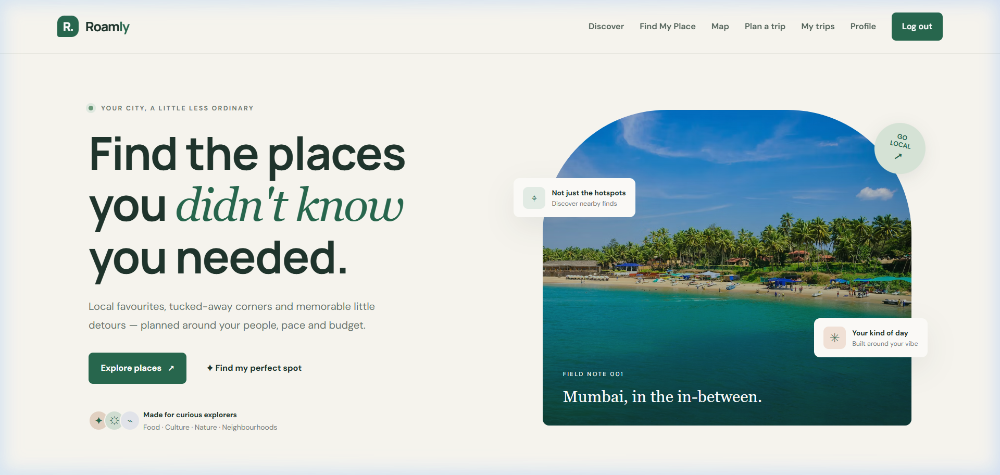
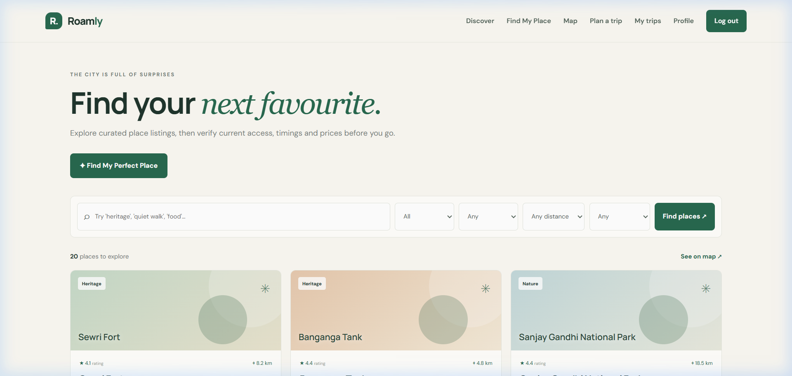
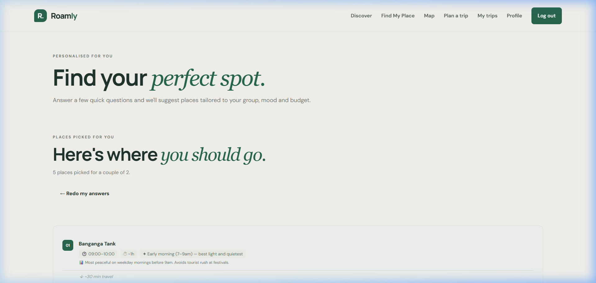
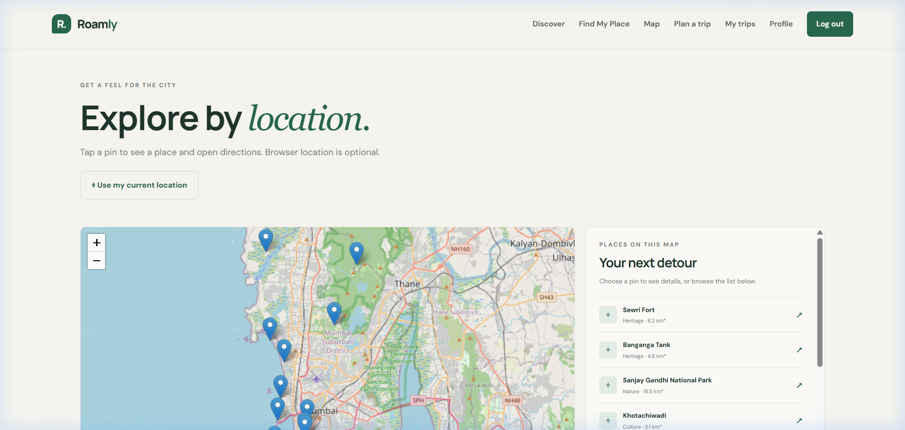
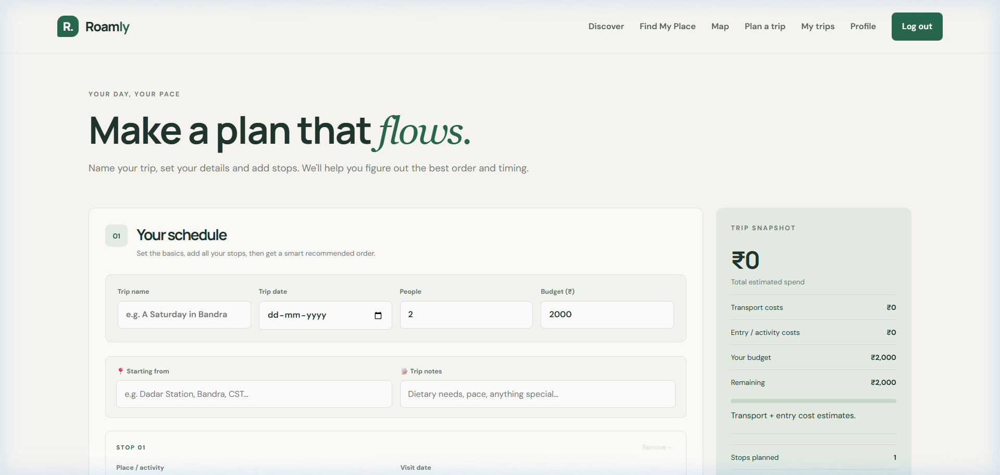
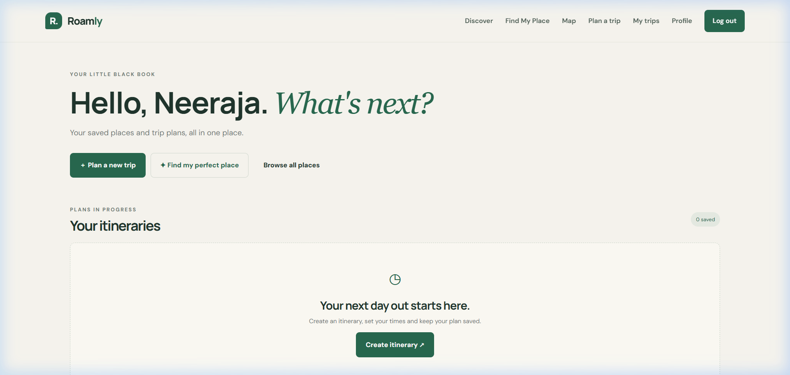

# Hidden Gems — Full-stack prototype

A responsive light-theme web prototype for **PS02: Hidden Gems – Local City Discovery Platform**. Built with Flask, SQLite, HTML, CSS and JavaScript.

## Included features
- Landing page introducing the platform and its features
- Email/password sign-up and sign-in; password hashes stored in SQLite
- User profile and default starting-location field
- Discover page with search and filters for category, budget, distance and interests
- Interactive Leaflet map using OpenStreetMap tiles, optional browser geolocation, and Google Maps directions links
- Saved places collection
- Itinerary planner with multiple stops, date, start/end time, travel mode, group size, budget and notes
- Live prototype calculation of estimated transport costs vs group budget
- Saved itineraries, schedule detail page and delete action
- JSON demo endpoint at `/api/places`
- Responsive desktop/mobile styling

## Visual Tour & Screenshots

| Landing Page | Discovery Engine |
| :---: | :---: |
|  |  |

| Personalized Finder | Interactive Map |
| :---: | :---: |
|  |  |

| Smart Itinerary Planner | My Trips Dashboard |
| :---: | :---: |
|  |  |

## Run locally (Windows)
1. Install Python 3.10 or newer.
2. Extract the ZIP and open this folder in VS Code.
3. Open the VS Code terminal in this folder.
4. Create a virtual environment:
   ```powershell
   py -m venv .venv
   .venv\Scripts\Activate.ps1
   ```
5. Install dependencies:
   ```powershell
   pip install -r requirements.txt
   ```
6. Start the app:
   ```powershell
   python app.py
   ```
7. Open `http://127.0.0.1:5000` in your browser. Create an account, save a place, and make an itinerary.

## Run on macOS/Linux
```bash
python3 -m venv .venv
source .venv/bin/activate
pip install -r requirements.txt
python app.py
```
Then open `http://127.0.0.1:5000`.

## Data and integration notes
- The app creates `hidden_gems.db` automatically on first run. It stores user accounts, saved places, itineraries and itinerary stops.
- The included Mumbai places are **sample prototype data**. Coordinates, distances, ratings, opening information and prices are illustrative/approximate and must be verified before any real travel use. There is no live review feed or live fare API.
- The map uses Leaflet and OpenStreetMap tiles; attribution is included. Respect OpenStreetMap tile usage policy if you deploy publicly.
- Google Maps URLs open external directions. Live traffic, in-app navigation, live public transport schedules and live prices are not integrated.
- Email/password authentication works locally. Google OAuth and mobile OTP need real provider credentials and callback configuration, so they are clearly not presented as working integrations.
- SQLite is suitable for a local prototype. For deployment, set a strong `SECRET_KEY`, use HTTPS, add CSRF protection and rate limiting, email verification/password reset, privacy/consent pages, and consider PostgreSQL. Do not deploy with Flask debug mode enabled.

## Suggested prototype demo flow
1. Sign up with a test email and password.
2. Discover places and try category/distance/budget filters.
3. Save a place.
4. Open the map and try the location button (requires browser permission and localhost/HTTPS).
5. Plan an itinerary with 2–3 stops, times and transport cost estimates.
6. Save it and show the schedule, total estimated transport and group budget.

## Main files
- `app.py` — Flask routes, password hashing, SQLite schema and sample place records
- `templates/` — page templates
- `static/style.css` — responsive visual design
- `static/app.js` — itinerary interactions and cost calculation
